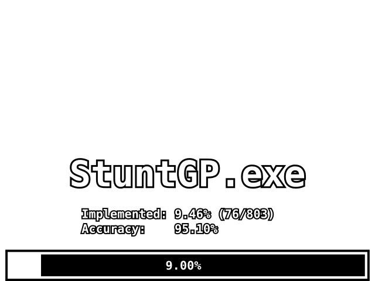
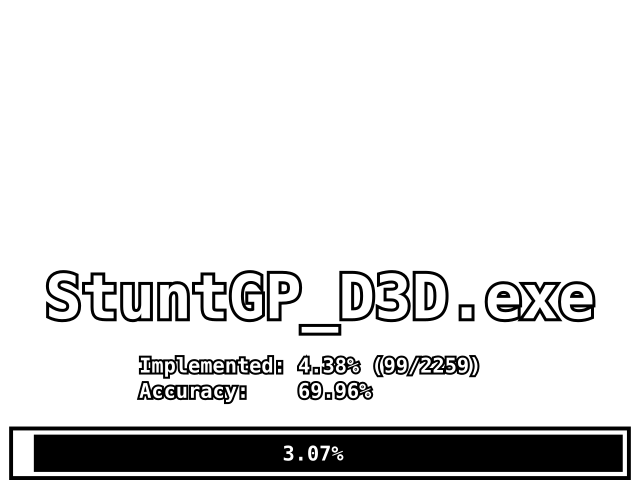

# ReGP

ReGP is a decompilation of **Stunt GP** aiming for a 1:1 byte-for-byte match with the original executables, loosely based on the [LEGO Island Decompilation](https://github.com/isledecomp/isle) project.

## Game versions

### International PC version

This decompilation is based on the international PC version of the game, identified by the following files and their sha256 checksums:

| File | SHA-256 |
| --- | --- |
| `config.exe` | `9c234da54a05392455a44b2d38482eefd303fd200a75c8703e32074989486214` |
| `StuntGP_D3D.exe` | `4a1d234ce1f095a427bb7f2f0174294b8c85a8fdbbc29b62a3863156b2f16a1b` |
| `StuntGP.exe` | `e4d2c2641c0028c6106de0e18d23ebd305d9af08fda4fbcc891540e92a1207a9` |
| `StuntGP_Glide.exe` | `2c1513cb0438180db0099850d5a449afe1ac5658c89348e49bb952386a872655` |

## Status

<!---->

## Building and comparison

See [CONTRIBUTING.md](CONTRIBUTING.md) for how to set up your environment, build the project, and compare the result against the original binaries.

## Usage

In theory when enough work is done you could just put the compiled executables in the game directory and run them. Currently this is a very bad idea, as not much works (yet).

## What's working

- Fullscreen window gets created, no DirectX surface yet

## TODO

- check if init of all variables is done in a `{}` manner.
- make sure TCHAR is used everywhere, the Polish version was compiled with UNICODE support.
